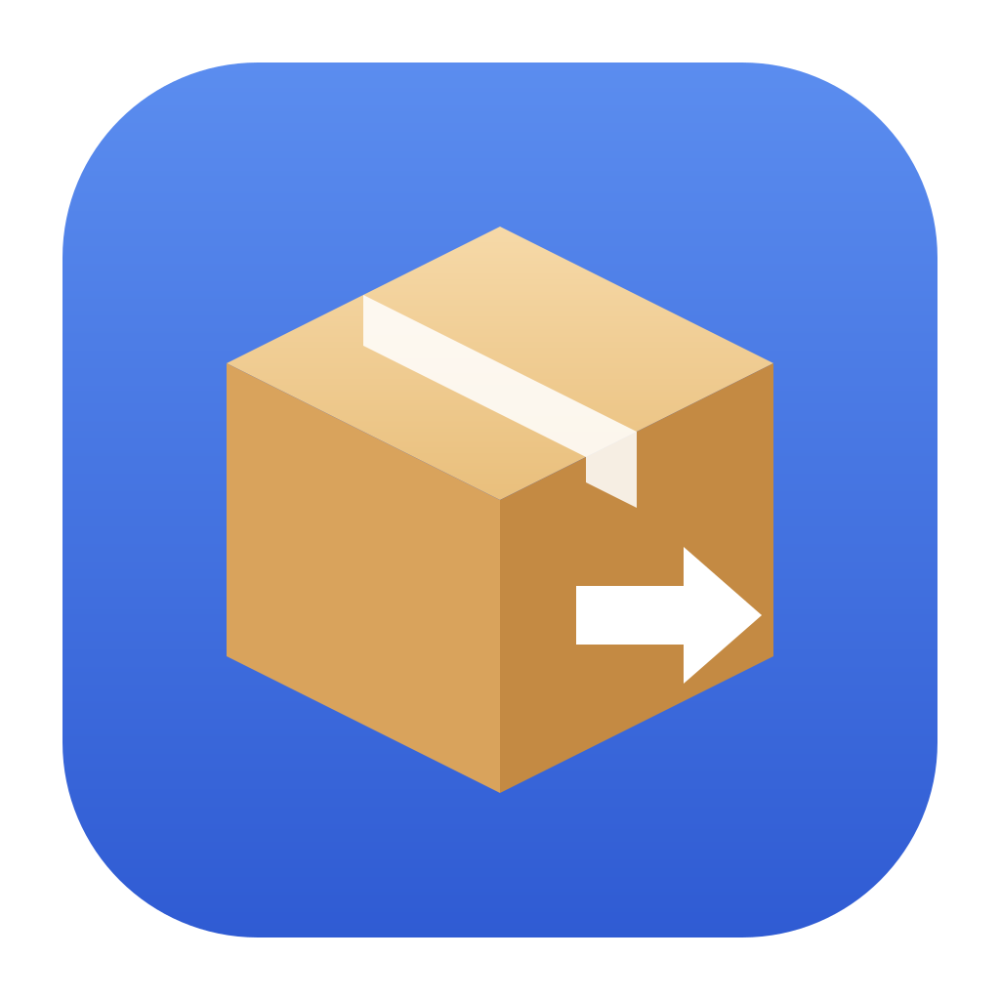
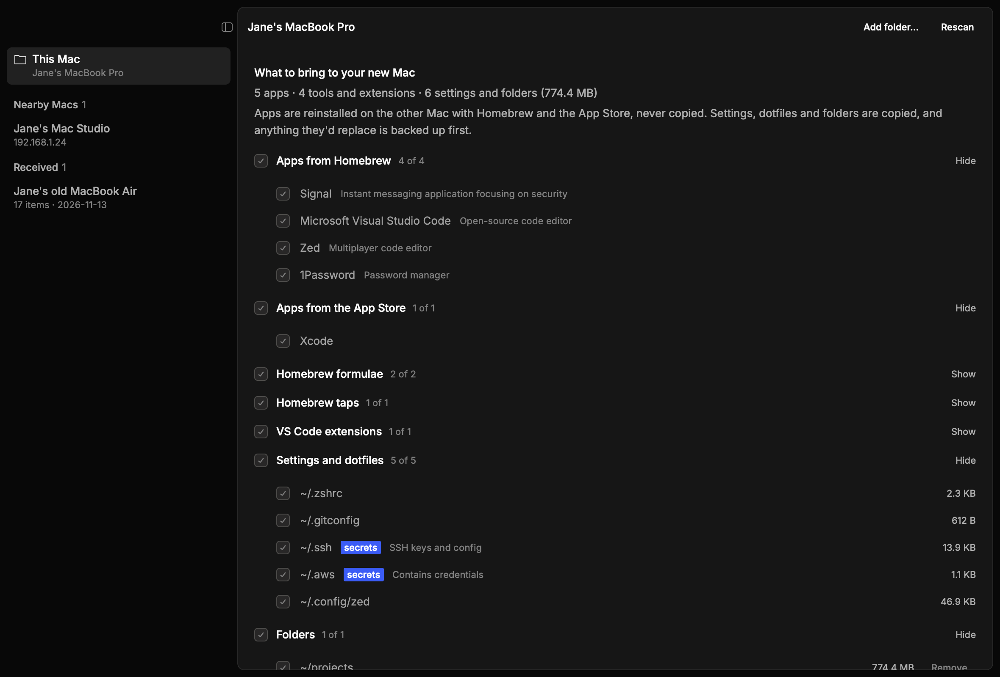

<p align="center">
  
</p>

<h1 align="center">macpack</h1>

<p align="center">
  <a href="https://github.com/vangheem/macpack/releases/latest"></a>
  <a href="https://github.com/vangheem/macpack/actions/workflows/ci.yml"></a>
  <a href="LICENSE"></a>
</p>

A native Mac app for moving your setup to a new Mac. Run it on both Macs: they find each other
on the local network, the old one sends a package over an encrypted connection, and the new
one reinstalls your apps and restores your settings. It's built with
[Rune](https://github.com/anomalyco/rune), a GPU-rendered Rust UI framework.

macpack moves a description of your setup, not a disk image. Apps are reinstalled from Homebrew
and the App Store rather than copied. Settings, dotfiles, SSH keys and the folders you choose
are copied.



## What it brings

| | How it gets to the new Mac |
| --- | --- |
| Homebrew taps, formulae and casks | Reinstalled with `brew bundle` |
| Apps you installed by hand (Signal, Chrome, Zed…) | Matched to their Homebrew cask and reinstalled |
| App Store apps | Reinstalled with [`mas`](https://github.com/mas-cli/mas) |
| Dotfiles and `~/.config/*` | Copied, including `~/.ssh` (permissions are fixed) |
| Folders you add (`~/projects`) | Copied, minus `node_modules`, `.venv` and `__pycache__` |
| macOS preferences (Dock, Finder, trackpad…) | `defaults export` / `import`; off unless you turn them on |
| Apps with no cask | Listed as a checklist to install by hand |

Caches, shell history, toolchains (`~/.cargo`, `~/.rustup`, `~/.nvm`…) and other state that
rebuilds itself are left out. Dotfiles larger than 20 MB start unselected. Items holding
credentials (`~/.ssh`, `~/.aws`, `~/.config/gh`…) are flagged.

## Use

1. Install and open macpack on both Macs, on the same network.
2. On the old Mac, check what to bring under **This Mac**. Your choices are remembered.
3. Pick the new Mac under **Nearby Macs** and click **Send**. If it doesn't show up, click
   **Connect…** and type the address the new Mac shows at the bottom of Nearby Macs
   (macpack listens on port 47321). `macpack ping <address>` checks it from a terminal, and `macpack peers` shows what
   discovery finds. Besides Bonjour, macpack sweeps the local subnet for port 47321 every 30
   seconds, which finds Macs on networks that block multicast.
4. Both Macs show a 6-digit code. If they match, click **Codes match, accept** on the new Mac.
5. The package arrives under **Received**. Untick anything you don't want, then
   **Apply to this Mac**.

While a package moves, both Macs switch to a transfer screen with each step, the code,
progress, speed, time left and an activity log. The package is packed into a file first, so a
dropped or stalled connection is retried automatically (with backoff, up to 30 attempts) and
picks up at the byte where it stopped, without a new code. The receiver checks the size and
SHA-256 before filing it; a damaged package is sent again. An interrupted transfer also
resumes after the receiving Mac's macpack restarts.

Applying copies files first (so apps find their settings when they're installed), then runs
`brew bundle`, then imports preferences. A file that would be replaced is moved to
`~/.local/share/macpack/applied/<time>/backup/` first. Homebrew must be installed on the new Mac
([brew.sh](https://brew.sh)), and App Store apps need you to be signed in to the App Store.

`macpack brewfile` prints the Brewfile for this Mac, and `macpack inventory` prints everything
macpack found as JSON.

## Security

- Each transfer uses fresh X25519 keys. Both directions are encrypted with
  ChaCha20-Poly1305, using keys derived with HKDF-SHA256.
- The 6-digit code is derived from the handshake. Someone intercepting the connection would
  have different keys with each Mac, so the codes wouldn't match. The sender commits to its
  key before seeing the receiver's, so an attacker can't search for keys that produce
  matching codes.
- Reconnects of an accepted transfer mix a secret from the verified first connection into
  their keys, so they need no new code and can't be taken over by anyone else.
- Nothing is accepted without a click on the receiving Mac, and nothing is applied until you
  review the package.
- Received packages hold your keys. They're stored owner-only in
  `~/.local/share/macpack/inbox/`. Delete them from the app once they're applied.

## Install

### Homebrew

```sh
brew install vangheem/tap/macpack
```

This also installs `mas`. macpack checks for new releases at launch and every few hours; when
there is one, an "Update available" row appears at the bottom of the sidebar.

#### As a Mac app

```sh
macpack install-app      # creates ~/Applications/macpack.app
macpack uninstall-app    # removes it
```

macpack also offers to do this the first time you start it from a terminal. The app is created
on your Mac rather than downloaded, so macOS doesn't block it even though macpack isn't signed.

macOS asks to allow macpack on the local network (and the firewall may ask to accept incoming
connections) the first time it runs. Allow both, or the Macs can't find each other.

### Prebuilt binary

```sh
curl -L https://github.com/vangheem/macpack/releases/latest/download/macpack-macos-universal.tar.gz | tar xz
mkdir -p ~/.local/bin && mv macpack ~/.local/bin/
```

### From source

```sh
make install          # builds a release binary into ~/.local/bin/macpack
```

## Data

Everything macpack keeps is under `~/.local/share/macpack/` (or `$XDG_DATA_HOME/macpack`):

- `state.json`: this Mac's network id, the folders you added and what you ticked.
- `inbox/`: received packages (`<id>.json` manifest and `<id>.tar.gz` files).
- `applied/<time>/`: the Brewfile, preferences and backups from each apply.
- `cask-apps.json`: Homebrew's app-to-cask map, refreshed weekly.

## Releasing

Run the **Release new version** workflow from the Actions tab (or
`gh workflow run bump-version.yml -f bump=patch`). It bumps the version, commits to `main` and
pushes a `vX.Y.Z` tag, which builds the binary, publishes the GitHub release and updates the
formula in [vangheem/homebrew-tap](https://github.com/vangheem/homebrew-tap).

The workflows need two repository secrets: `RELEASE_DEPLOY_KEY` (a deploy key with write access
to this repo) and `HOMEBREW_TAP_DEPLOY_KEY` (one with write access to the tap).

## Development

```sh
make run      # debug build
make test     # offline tests
make lint     # clippy, warnings as errors
cargo test -- --ignored   # also uses the real network (mDNS) and GitHub
```

Render headlessly to check UI changes without a window:

```sh
cargo run -- --snap out.png --scene demo --size 1180x800 --theme dark
cargo run -- --list-scenes
```

### Layout

- `src/main.rs`: app state, background jobs and all views.
- `src/inventory.rs`: scanning this Mac.
- `src/package.rs`: building, unpacking and applying packages.
- `src/net.rs`: the encrypted transfer.
- `src/discovery.rs`: finding other Macs over mDNS.
- `src/store.rs`: persisted state.

## License

MIT
